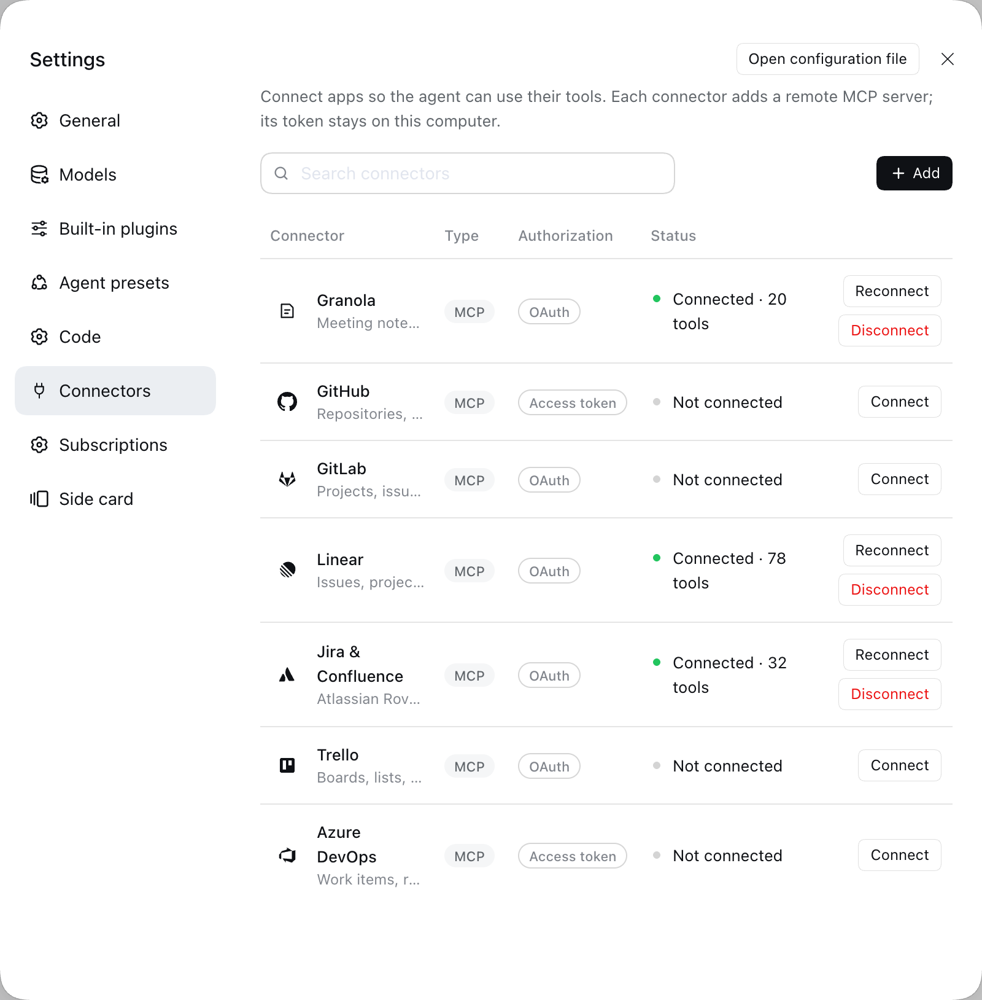
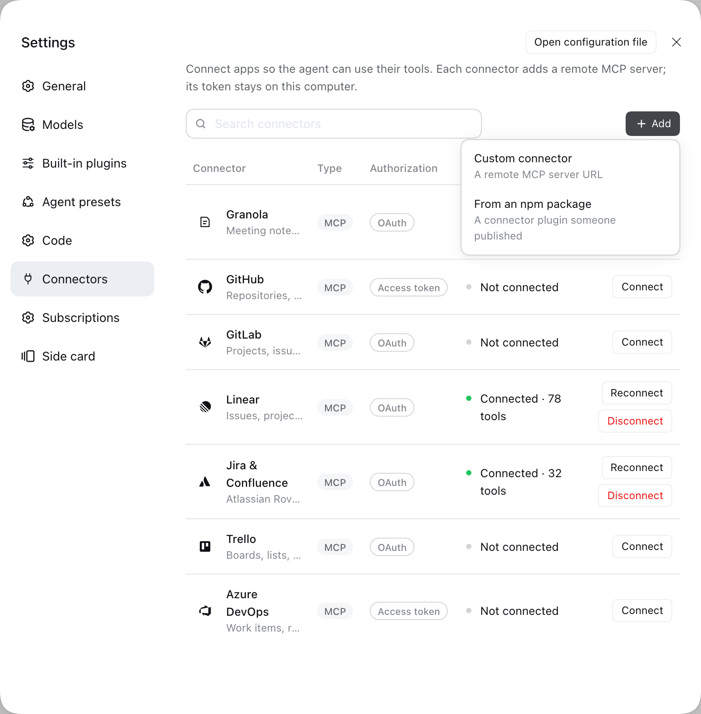
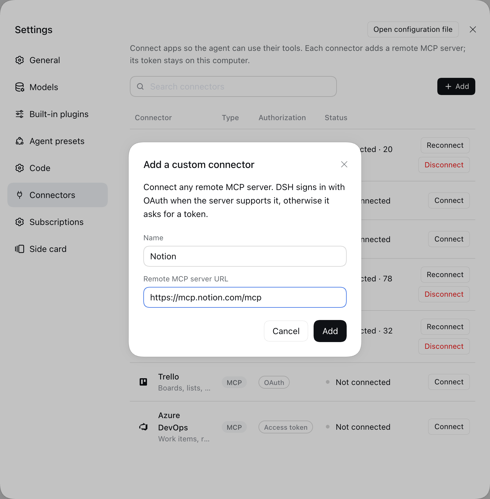
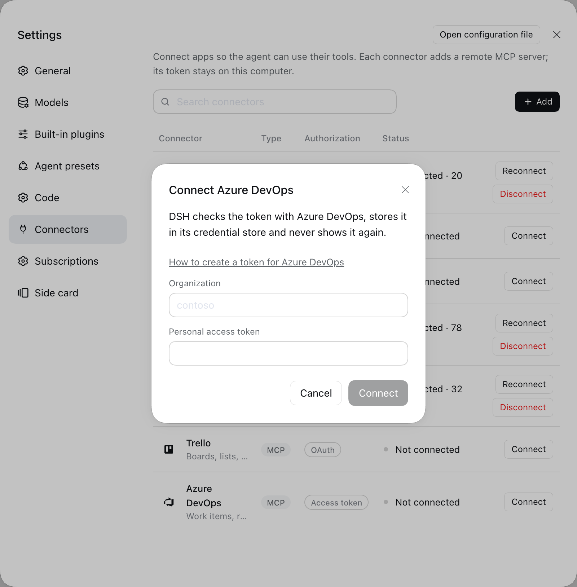
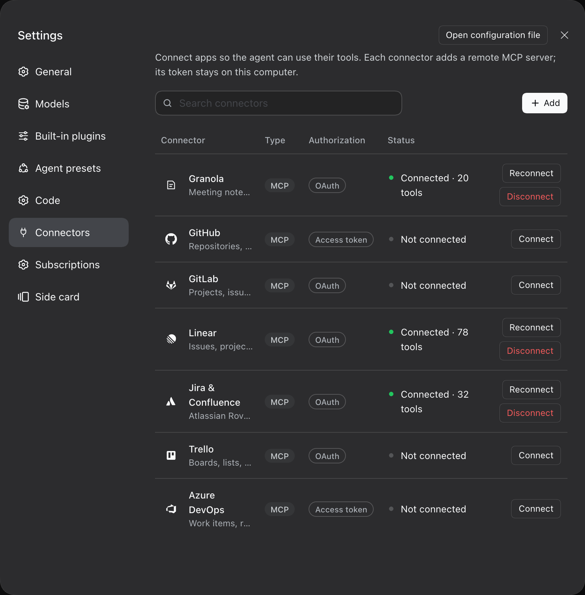

# Connectors for DeepSeek Harness

Adds a **Connectors** page to Settings, like the connectors page in Claude. Each connector adds an MCP server to DSH, so every session in that dsh (chats, subagents, automation tasks) can use its tools, named `mcp__<connector>__<tool>`. The page lists the connectors in a table (**Connector**, **Type**, **Authorization**, **Status**) with a search field, and an **Add** menu for your own.



| Add a connector | Custom MCP server | Token sign-in |
|---|---|---|
|  |  |  |



| Connector | Authorization | Server |
|---|---|---|
| Granola | OAuth | `https://mcp.granola.ai/mcp` |
| Linear | OAuth | `https://mcp.linear.app/mcp` |
| Jira & Confluence | OAuth (Atlassian Rovo MCP, one sign-in for both) | `https://mcp.atlassian.com/v1/mcp` |
| Trello | OAuth | `https://mcp.trello.com/v1` |
| GitHub | OAuth with your GitHub App ([setup](#github-oauth-your-github-app)), or a personal access token | `https://api.githubcopilot.com/mcp/` |
| GitLab | OAuth | `https://gitlab.com/api/v4/mcp` |
| Azure DevOps | Organization + personal access token | Microsoft's local server, `npx @azure-devops/mcp@2.11.0`, run by the MCP manager |

Granola, Linear, Jira & Confluence, Trello and GitLab register their client by themselves (Dynamic Client Registration), so they need no setup. GitHub does not, so its OAuth needs a GitHub App you register once; until then it takes a token.

Plus:

- **Add → Custom connector**: a name and a remote MCP URL. DSH uses OAuth when the server supports Dynamic Client Registration, otherwise it asks for a bearer token.
- **Add → From an npm package**: a connector plugin that follows the [connector package standard](#connector-package-standard).

## How it works

- DSH's MCP manager (`@deepseek-ai/dsh-mcp-manager`) runs the servers. This plugin adds what the manager lacks, sign-in and a page: it registers each connected connector with `ctx.mcpManager.register()`.
- The server reads its token through a `${credential:DSH_CONNECTORS_<ID>_TOKEN}` template. The token stays in DSH's credential store under `$DSH_HOME`, so a renewed token reaches the server without re-registering. The browser page sends a pasted token once and never reads one back.
- **OAuth flow**:
  1. Discovery (RFC 9728/8414).
  2. Dynamic Client Registration, or a client you configure (GitHub).
  3. Authorization code with PKCE (S256), a random `state`, and a one-shot callback on `http://127.0.0.1:<random port>/callback` that closes after 10 minutes.
  4. The access token is renewed 5 minutes before it expires, and on start if it already has.

  The refresh token and client id live in the `dsh-connectors/<id>` credential record. The protocol steps come from `@modelcontextprotocol/client`, the MCP SDK the harness uses.
- Status comes from the MCP manager: Connected (with the tool count), Connecting, Error (with the server's message), or Not connected. The page refreshes every 2 seconds while it is open.
- **Disconnect** removes the server and deletes the stored token. **Remove** also deletes a custom connector.

### GitHub OAuth: your GitHub App

GitHub's MCP server has no Dynamic Client Registration, and Claude's GitHub App only redirects to claude.ai. So OAuth uses a GitHub App you register once. No domain is needed.

1. Open <https://github.com/settings/apps/new> and fill it in:
   - **GitHub App name**: for example `DSH Connectors` (it must be unique on GitHub).
   - **Homepage URL**: any URL, for example this repository.
   - **Callback URL**: add both `http://127.0.0.1/callback` and `http://localhost/callback` (**Add Callback URL**). DSH redirects to `127.0.0.1` on a random port. GitHub's MCP server docs say GitHub ignores the port for loopback callbacks, but only show `localhost`.
   - **Expire user authorization tokens**: on. DSH renews them.
   - **Request user authorization (OAuth) during installation**: off.
   - **Webhook → Active**: off.
   - **Repository permissions**: Contents, Issues, Pull requests, Actions and Workflows read and write; Metadata, Checks, Commit statuses and Discussions as you need.
   - **Where can this GitHub App be installed**: "Any account" if others will use your plugin, otherwise "Only on this account".
2. Create it. Copy the **Client ID**, click **Generate a new client secret**, and note the app's slug from its URL (`github.com/apps/<slug>`).
3. Add `github: { clientId, clientSecret, appSlug }` to the [config](#app-and-client-config).

4. Restart dsh. GitHub now offers **Connect** (OAuth) and **Use a token**.
5. After signing in, **Choose repositories** opens the app's installation page, where you install it on accounts and organizations and pick repositories. This is the same step Claude shows.

GitHub's documentation treats the secret of a distributed client as non-confidential. If the app is public, its id and secret can ship as this plugin's defaults, so users skip these steps.

### App and client config

The GitHub App goes in `$DSH_HOME/cordis.patch.yml` (every profile) or a profile's `cordis.patch.yml`, then restart dsh:

```yaml
- id: connectors
  config:
    github: { clientId: Iv23li…, clientSecret: …, appSlug: dsh-connectors }
```

### Azure DevOps

Microsoft's remote server (`mcp.dev.azure.com/<org>`) signs in through Entra ID in your organization's tenant. Entra has no Dynamic Client Registration, so it would need an app registration, usually with admin consent. The connector therefore runs Microsoft's local server instead, with a PAT:

- Create a PAT at `https://dev.azure.com/<org>/_usersSettings/tokens`, with the scopes the tools need (Work Items, Code, Build, Wiki, …).
- The connector checks the PAT against `_apis/connectionData`, stores it in the form `@azure-devops/mcp` reads, and starts `npx -y @azure-devops/mcp@2.11.0 <org> --authentication pat`.

The first start downloads the package, so it can take up to 3 minutes. The version is pinned, so an update is a code change here.

## Adding connectors from another plugin

The plugin provides the `connectors` service. Another plugin injects it and registers definitions inside an effect, so its rows disappear when it unloads. Stored credentials stay, and come back when the plugin returns.

```ts
import type { ConnectorsService } from '@gabrielbav/dsh-connectors'

export const name = 'dsh-connector-linear'
export const inject = ['connectors']

export function apply(ctx: { connectors: ConnectorsService; effect(run: () => () => void): void }) {
  ctx.effect(() => ctx.connectors.register({
    id: 'linear',                        // [a-z][a-z0-9-]{0,31}: MCP server name and credential id
    name: 'Linear',
    description: 'Issues and projects',
    icon: '<svg viewBox="0 0 24 24">…</svg>', // drawn in the text color
    oauth: { resourceUrl: 'https://mcp.linear.app/mcp' }, // Dynamic Client Registration
    server: ({ credential }) => ({
      transport: 'streamable-http',
      url: 'https://mcp.linear.app/mcp',
      headers: { Authorization: `Bearer ${credential}` },
    }),
  }))
}
```

[`examples/connector-example`](https://github.com/gabrielbav/dsh-workspace/tree/main/Plugins/dsh-connectors/examples/connector-example) is a complete, minimal connector package that follows the standard below. Linking it into a profile adds an "Example" row, and removing it takes the row away.

The full contract is in [`src/host/api.ts`](https://github.com/gabrielbav/dsh-workspace/blob/main/Plugins/dsh-connectors/src/host/api.ts):

- `oauth` takes `client` for a pre-registered app, plus `scopes`, `identify` and `setupUrl`.
- `token` takes form `fields` and a `verify` that checks the values and returns the credential to store.
- `server` can return a `stdio` server whose `env` receives the credential.

## Connector package standard

**Add → From an npm package** installs only packages whose published `package.json` has:

```json
{
  "keywords": ["dsh-connector"],
  "dsh": {
    "bundle": { "patch": "./cordis.patch.yml" },
    "connector": { "ids": ["linear"] }
  }
}
```

It also refuses a package with a browser half (`dsh.client`): a connector is a Host-side definition, so it has no reason to change the UI.

The check runs on the registry manifest before anything downloads, and again at install time. The install then goes through the harness plugin manager with the exact version (`expected`, `saveExact`). Registered install gates (such as [Airlock](https://github.com/gabrielbav/dsh-workspace/tree/main/Plugins/dsh-plugin-airlock)) scan it first. A gate's review is shown on the page with an **Install anyway**, and a block stops the install.

The standard filters out packages that are not connectors. It is not a security boundary: a connector package is code that runs in the Host with your permissions, which is why the install gate matters.

## Install

From the Plugins page: **Add plugin** → `@gabrielbav/dsh-connectors`. Or from the command line:

```sh
dsh plugin --profile web add -w @gabrielbav/dsh-connectors
```

Restart dsh, then open **Settings → Connectors**. The plugin needs the `mcp-manager` and `credentials` services, which the Web and Desktop profiles mount. Package installs also need the plugin manager. It needs no harness fork.

From a checkout, in the DSH workspace: `make plugins P=connectors`, then `make start P=connectors`.

## Limitations

- **The OAuth callback is on the Host's loopback.** The browser must run on the same computer as dsh.
- **No needs-auth state in the MCP manager.** A token a server revokes mid-session shows as a connection error after the manager's reconnect attempts. Use **Connect again**.
- **Every sign-in through Dynamic Client Registration registers a new client**, because the callback port changes each time.
- **GitLab is gitlab.com only.** A self-managed instance can be added as a custom connector (`https://<host>/api/v4/mcp`). GitLab's MCP server is in beta, and your plan or instance settings may not offer it.
- **Only English and Portuguese** are translated. Other DSH languages show English. Labels that connector definitions supply are shown as written.

## Develop

```sh
corepack pnpm@11.28.5 install
corepack pnpm@11.28.5 run typecheck
corepack pnpm@11.28.5 test
corepack pnpm@11.28.5 run build   # then restart dsh
```

| File | Role |
|---|---|
| `src/host/api.ts` | Public `connectors` service contract |
| `src/host/connectors.ts` | Registry: sign-in, renewal, MCP registration, status |
| `src/host/oauth.ts` | Loopback callback and the OAuth steps |
| `src/host/builtins.ts` | Granola, GitHub, GitLab, Azure DevOps |
| `src/host/custom.ts` | Custom URL connectors |
| `src/host/packages.ts` | Connector package standard and installs |
| `src/host/index.ts` | Config, service, `/api/connectors.<endpoint>` routes |
| `src/client/ui.tsx` | Settings page and dialogs |
